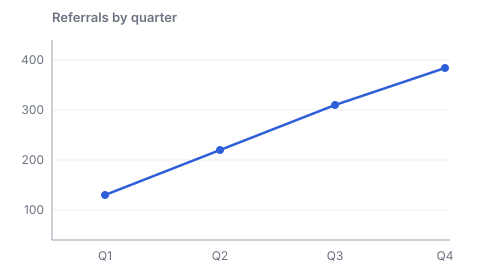

::: {.cheat-hero}
**What this is.** A personal reference for the markdown, YAML, Quarto-specific,
HTML and CSS syntax I actually reach for when building bespoke `.qmd` reports.
Ordered so each section builds on the last: plain markdown first, then the YAML
that configures it, then the Quarto layer on top, then the HTML and CSS escape
hatches for everything else.

**How to read it.** Most entries show the syntax on the left and the real
rendered result on the right. This page *is* a Quarto document — every
"Renders as" panel is genuine Quarto output rather than a mock-up, so what you
see is exactly what the syntax next to it will give you.

**Getting around.** Use the contents list on the left; press <kbd>/</kbd> to
filter it, <kbd>Esc</kbd> to clear. Hover any code block to copy it. The
toggle in the top-right switches between light and dark.
:::

## Start here: a minimal `.qmd` {.unnumbered}

Everything else on this page is a variation on this skeleton — YAML front
matter between `---` fences, then markdown body, then code chunks where you
need computation.

````markdown
---
title: "Monthly Activity Report"
author: "Jasper"
date: last-modified
format:
  html:
    toc: true
    embed-resources: true
execute:
  echo: false
  warning: false
---

## Summary

There were `r nrow(admissions)` admissions this month.

```{r}
#| label: fig-trend
#| fig-cap: "Admissions by week"

ggplot(admissions, aes(week, n)) + geom_line()
```

See @fig-trend for the trend.
````

Render it with `quarto render report.qmd`, or `quarto preview report.qmd` for a
live-reloading preview while you write.

---

## Markdown {#sec-markdown}

Pandoc-flavoured markdown, which is what Quarto parses. This is the base layer
everything else sits on top of.

### Headings

```markdown
# H1
## H2
### H3
#### H4
##### H5
###### H6
```

Quarto builds the table of contents from these, so keep them hierarchical
(don't skip from H2 to H4). The `##` headings in this page are what produced
the numbered entries in the contents list on the left.

::: {.callout-warning title="Gotcha"}
In a `.qmd` the document title comes from the YAML `title:` field, not from an
`# H1` in the body. Adding your own `# H1` gives you two competing titles.
:::

### Emphasis

:::: {.demo}
::: {.demo-src}
```markdown
*italic* or _italic_

**bold** or __bold__

***bold italic***

~~strikethrough~~
```
:::
::: {.demo-out}
*italic* or _italic_

**bold** or __bold__

***bold italic***

~~strikethrough~~
:::
::::

### Superscript and subscript

:::: {.demo}
::: {.demo-src}
```markdown
x^2^ superscript

H~2~O subscript
```
:::
::: {.demo-out}
x^2^ superscript

H~2~O subscript
:::
::::

### Paragraphs and line breaks

:::: {.demo}
::: {.demo-src}
```markdown
This is one paragraph.

This is a new paragraph
(blank line above).

This line ends with two spaces
so this continues on a new line,
same paragraph.

This line ends with a backslash\
same effect as trailing spaces.
```
:::
::: {.demo-out}
This is one paragraph.

This is a new paragraph
(blank line above).

This line ends with two spaces
so this continues on a new line,
same paragraph.

This line ends with a backslash\
same effect as trailing spaces.
:::
::::

The backslash form is worth preferring — trailing spaces are invisible in the
editor and most formatters strip them.

### Lists

:::: {.demo}
::: {.demo-src}
```markdown
- Unordered item
- Another item
  - Nested item (indent 2–4 spaces)

1. Ordered item
2. Another item
   1. Nested ordered item

- [ ] Unchecked task
- [x] Checked task
```
:::
::: {.demo-out}
- Unordered item
- Another item
  - Nested item (indent 2–4 spaces)

1. Ordered item
2. Another item
   1. Nested ordered item

- [ ] Unchecked task
- [x] Checked task
:::
::::

`*` and `+` also work as unordered markers, but mixing markers in one list
starts a *new* list rather than continuing the old one — pick one and stick
with it.

### Links

:::: {.demo}
::: {.demo-src}
```markdown
[link text](https://quarto.org)

[with a hover title](https://quarto.org "Quarto homepage")

[reference-style link][qref]

[qref]: https://quarto.org

<https://quarto.org>
```
:::
::: {.demo-out}
[link text](https://quarto.org)

[with a hover title](https://quarto.org "Quarto homepage")

[reference-style link][qref]

[qref]: https://quarto.org

<https://quarto.org>
:::
::::

Reference definitions (`[qref]: …`) can sit anywhere in the document and never
render themselves — handy for keeping long URLs out of the prose.

### Images

:::: {.demo}
::: {.demo-src}
```markdown


{width=60%}
```
:::
::: {.demo-out}


{width=60%}
:::
::::

::: {.callout-warning title="Gotcha"}
The `{width=…}` attribute syntax is a Quarto/Pandoc extension, not pure
CommonMark. It looks like plain markdown but won't do anything outside
Quarto/Pandoc rendering — a GitHub README, for instance, will ignore it.
:::

Alt text doubles as the caption when the image is a cross-referenceable figure
(see @sec-crossrefs), so write it as a caption rather than leaving it empty.

### Tables

:::: {.demo}
::: {.demo-src}
```markdown
| Column A | Column B | Column C |
|:---------|:--------:|---------:|
| left     | centre   | right    |
| aligned  | aligned  | aligned  |
```
:::
::: {.demo-out}
| Column A | Column B | Column C |
|:---------|:--------:|---------:|
| left     | centre   | right    |
| aligned  | aligned  | aligned  |
:::
::::

`:---` left-aligns, `:---:` centres, `---:` right-aligns, plain `---` is
default. The source columns don't need to line up, but keeping them tidy makes
the raw file far easier to edit.

Add a caption (and a cross-reference label) with a `:` line underneath:

:::: {.demo}
::: {.demo-src}
```markdown
| Metric | Value |
|--------|------:|
| Referrals | 412 |
| Seen in 18 weeks | 96% |

: Performance summary {#tbl-perf}
```
:::
::: {.demo-out}
| Metric | Value |
|--------|------:|
| Referrals | 412 |
| Seen in 18 weeks | 96% |

: Performance summary {#tbl-perf}
:::
::::

### Blockquotes

:::: {.demo}
::: {.demo-src}
```markdown
> A single-level quote.
>
> > A nested quote.
```
:::
::: {.demo-out}
> A single-level quote.
>
> > A nested quote.
:::
::::

### Code

:::: {.demo}
::: {.demo-src}
````markdown
Inline `code` uses single backticks.

```r
# a fenced block, with a language
# for syntax highlighting
mean(x, na.rm = TRUE)
```
````
:::
::: {.demo-out}
Inline `code` uses single backticks.

```r
# a fenced block, with a language
# for syntax highlighting
mean(x, na.rm = TRUE)
```
:::
::::

To show a code fence *inside* a code block (as this page does constantly), wrap
the outer fence in four backticks instead of three.

::: {.callout-warning title="Gotcha"}
A fence tagged with a bare language name, `` ```r ``, is a display-only block.
Add braces, `` ```{r} ``, and the same fence becomes an *executable chunk* that
Quarto runs. One character apart, completely different behaviour — see
@sec-chunks.

A related trap: an inline code span containing backticks has to be written with
*more* backticks than it contains, and it must not start a line — Pandoc reads
a line-initial run of three or more backticks as a code fence, whatever you
meant by it.
:::

### Horizontal rule

:::: {.demo}
::: {.demo-src}
```markdown
---

***

___
```
:::
::: {.demo-out}
---

***

___
:::
::::

All three produce a horizontal rule — pick one and be consistent. I'd suggest
`---`, but note that's also the YAML delimiter, so make sure it has blank lines
around it in the body.

### Footnotes

:::: {.demo}
::: {.demo-src}
```markdown
Here's a claim that needs a source.[^src]

[^src]: The footnote text, which can go
    anywhere in the document.
```
:::
::: {.demo-out}
Here's a claim that needs a source.[^src]

[^src]: The footnote text, which can go anywhere in the document — it always
    renders at the bottom of the page, not where you wrote it.
:::
::::

Only the marker appears inline; the text is collected at the end of the
document (scroll to the bottom of this page to see the one above).

### Math notation

Renders via MathJax automatically in HTML output — no YAML setup required.

:::: {.demo}
::: {.demo-src}
```markdown
Inline maths sits between single
dollar signs: $E = mc^2$

Display maths gets its own paragraph
and is centred:

$$
E = mc^2
$$
```
:::
::: {.demo-out}
Inline maths sits between single dollar signs: $E = mc^2$

Display maths gets its own paragraph and is centred:

$$
E = mc^2
$$
:::
::::

A numbered, cross-referenceable equation takes a `{#eq-…}` label:

:::: {.demo}
::: {.demo-src}
```markdown
$$
\sigma = \sqrt{\frac{\sum(x_i - \bar{x})^2}{n - 1}}
$$ {#eq-sd}

See @eq-sd for the definition.
```
:::
::: {.demo-out}
$$
\sigma = \sqrt{\frac{\sum(x_i - \bar{x})^2}{n - 1}}
$$ {#eq-sd}

See @eq-sd for the definition.
:::
::::

Common LaTeX symbols worth memorising:

```markdown
\alpha \beta \gamma \pi \sigma \Delta \Sigma
\leq \geq \neq \approx \times \pm \infty
\frac{a}{b}   \sqrt{x}   x^{2}   x_{i}
\sum_{i=1}^{n}   \int_{a}^{b}
```

Which give: $\alpha\ \beta\ \gamma\ \pi\ \sigma\ \Delta\ \Sigma\quad
\leq\ \geq\ \neq\ \approx\ \times\ \pm\ \infty\quad
\frac{a}{b}\ \sqrt{x}\ x^{2}\ x_{i}\quad \sum_{i=1}^{n}\ \int_{a}^{b}$

### Definition lists

:::: {.demo}
::: {.demo-src}
```markdown
Term
:   Definition of the term,
    indented under it.

Second term
:   Its definition.
```
:::
::: {.demo-out}
Term
:   Definition of the term, indented under it.

Second term
:   Its definition.
:::
::::

### Escaping characters

:::: {.demo}
::: {.demo-src}
```markdown
\*not italic\*

\# not a heading
```
:::
::: {.demo-out}
\*not italic\*

\# not a heading
:::
::::

### Comments

```markdown
<!-- This won't appear in the rendered output -->
```

::: {.demo-out}
<!-- proof: there is a comment on this line and you cannot see it -->
There is an HTML comment immediately above this line in the source, and it
produces nothing at all — which is the point.
:::

### Fenced divs and spans {#sec-divs}

The Pandoc extension that everything in @sec-quarto is built from. A fenced div
wraps block content in a `<div>` with the classes and attributes you give it; a
bracketed span does the same inline with a `<span>`.

:::: {.demo}
::: {.demo-src}
```markdown
::: {.highlight-box}
Content inside the div, which can
contain other **markdown**.
:::

Some text with a
[highlighted phrase]{.example-badge}
inline.
```
:::
::: {.demo-out}
::: {.highlight-box}
Content inside the div, which can contain other **markdown**.
:::

Some text with a [highlighted phrase]{.example-badge} inline.
:::
::::

`.highlight-box` and `.example-badge` are classes defined in this site's own
`custom.scss` — see @sec-css.

::: {.callout-tip title="Nesting divs"}
To nest one fenced div inside another, give the outer one *more* colons:
`::::` outside, `:::` inside. Every side-by-side example on this page is a
`::::{.demo}` wrapping two `:::` divs.
:::

---

## YAML {#sec-yaml}

YAML drives two things in a `.qmd`: the document front matter (between `---`
delimiters at the top of the file) and per-chunk options (the `#|` syntax in
@sec-chunks).

### Basic syntax rules

```yaml
key: value
nested:
  child-key: value
  another-child: value
list-value:
  - item one
  - item two
boolean-value: true      # lowercase true/false — not True/Yes
number-value: 42
quoted-string: "needed if the value has a colon: like this,
                or starts with a special character"
```

Indentation must be **spaces, not tabs**, and must be consistent — 2 spaces per
level is the common convention.

::: {.callout-warning title="Gotcha"}
A tab character anywhere in the front matter fails the whole render, usually
with an unhelpful message pointing at a line number that isn't the problem. If
YAML errors appear from nowhere, check for tabs first.
:::

### Multi-line strings

```yaml
folded: >
  This will be joined
  into a single line
  with spaces.

literal: |
  This will keep
  its line breaks
  exactly as typed.
```

### Comments

```yaml
# A comment — ignored by the parser
title: "My Report"  # inline comment
```

### Document front matter: common options

```yaml
---
title: "Monthly Activity Report"
subtitle: "Directorate summary"
author: "Jasper"
date: last-modified          # or a fixed date, or "today"
date-format: "D MMMM YYYY"   # UK-style date formatting
format:
  html:
    toc: true
    toc-depth: 3
    toc-location: left
    number-sections: true
    theme: cosmo
    css: styles.css
    code-fold: true
    code-tools: true
    page-layout: article       # article | full
    embed-resources: true      # single self-contained HTML file
    fig-width: 7
    fig-height: 5
execute:
  echo: false
  warning: false
  message: false
  freeze: auto                 # reuse previous execution unless source changes
---
```

`embed-resources: true` is the one to remember for anything you need to email
or drop on a shared drive: it inlines every image, script and stylesheet into a
single `.html` file that works with no supporting folder. (It replaced the
older `self-contained` option.)

### The front matter behind this page

Since the point of a cheatsheet is working examples, here is the actual YAML
that produced the page you're reading — a light theme and a dark theme, a
left-hand contents list, numbered sections and a widened body column:

```yaml
---
title: "Quarto Report Cheatsheet"
date: last-modified
date-format: "D MMMM YYYY"
engine: markdown          # no code is executed, so skip knitr/jupyter entirely
format:
  html:
    theme:
      light: [cosmo, custom.scss]
      dark: [darkly, custom.scss]
    toc: true
    toc-depth: 3
    toc-title: "On this page"
    toc-location: left
    toc-expand: 2
    number-sections: true
    number-depth: 3
    anchor-sections: true
    code-copy: true
    code-overflow: wrap
    link-external-newwindow: true
    embed-resources: true
    include-in-header: custom.js
    grid:
      sidebar-width: 290px
      body-width: 1000px
      margin-width: 220px
---
```

Supplying `theme:` with both `light:` and `dark:` keys is what puts the
light/dark toggle in the top-right corner. The `grid:` block widens the body
column from Quarto's fairly narrow default, which is what makes the two-column
examples on this page fit.

### Parameterised reports

```yaml
---
title: "Ward Report"
params:
  ward: "Ward 4"
  month: "2026-07"
---
```

Referenced in code via `params$ward` (R) or `params["ward"]` (Python), and
overridden at render time without editing the file:

```bash
quarto render report.qmd -P ward:"Ward 7" -P month:"2026-08"
```

That combination is what makes a "one report per ward" loop possible from a
single source file.

### Multiple output formats from one file

```yaml
format:
  html:
    toc: true
  docx:
    toc: false
```

`quarto render report.qmd` builds both; `quarto render report.qmd --to docx`
builds just the one.

### Anchors and aliases

Rarely needed, but useful for repeated blocks:

```yaml
defaults: &defaults
  echo: false
  warning: false

execute:
  <<: *defaults
  eval: true
```

---

## Quarto features {#sec-quarto}

Quarto-specific syntax layered on top of markdown: code chunks, callouts,
tabsets, layout and cross-references.

### Code chunk anatomy {#sec-chunks}

````markdown
```{r}
#| label: fig-sales-trend
#| echo: false
#| warning: false
#| fig-cap: "Sales trend by quarter"
#| fig-width: 8
#| fig-height: 5

ggplot(data, aes(x, y)) + geom_line()
```
````

Options go on lines starting `#|` at the top of the chunk (the "hash-pipe"
syntax). This is preferred over the older comma-separated `{r, echo=FALSE}`
style, which Quarto still supports but doesn't recommend for new documents.

::: {.callout-warning title="Gotcha"}
`#|` options must be the *first* lines in the chunk, with no blank line between
them. A blank line ends the options block, and everything after it is treated
as code — which usually surfaces as an option being silently ignored rather
than as an error.
:::

### Common chunk options

| Option | Effect |
|---|---|
| `label` | Chunk ID, used for cross-referencing (`fig-`/`tbl-` prefix required for figures/tables) |
| `echo` | Show the source code (`true`/`false`/`fenced`) |
| `eval` | Actually run the code (`true`/`false`) |
| `output` | Include the results (`true`/`false`/`asis`) |
| `include` | Catch-all: run the code but show neither code nor output (setup chunks) |
| `warning` / `message` | Suppress warnings / package-load messages |
| `error` | Allow the document to render even if the chunk errors |
| `fig-cap` / `fig-alt` | Figure caption / alt text |
| `fig-width` / `fig-height` | Figure dimensions in inches |
| `out-width` / `out-height` | Displayed size in the browser |
| `code-fold` | Collapse code behind a "Show the code" toggle |
| `code-summary` | Custom text for the fold toggle |
| `cache` | Reuse the chunk's previous output if the code hasn't changed |

: Chunk options in rough order of how often I use them {#tbl-chunk-opts}

Document-wide defaults for any of these go under `execute:` in the YAML front
matter (@sec-yaml); per-chunk `#|` options override the default for that one
chunk.

### Figure sizing: static vs dynamic width

Two different options control this, and mixing them up is the usual source of
confusion:

- **`fig-width` / `fig-height`** (inches) set the size of the graphics device
  the plot is *drawn* at. This changes the plot's internal proportions — a
  narrower `fig-width` with the same ggplot theme makes text and points look
  relatively larger, because everything is drawn onto a smaller canvas.
- **`out-width` / `out-height`** set how the *resulting image is displayed* in
  the browser (the HTML `width`/`height`/CSS), independent of how it was drawn.
  This is what you want for controlling on-page size without touching
  font/point proportions.

**Static size** — always the same physical size, regardless of column width:

````markdown
```{r}
#| fig-width: 8
#| fig-height: 5
#| out-width: "6in"

ggplot(data, aes(x, y)) + geom_line()
```
````

**Dynamic size** — fill whatever column it's placed in, so it automatically
resizes if you later wrap it in `.column-page` or `.column-body-outset`:

````markdown
```{r}
#| fig-width: 8
#| fig-height: 5
#| out-width: "100%"

ggplot(data, aes(x, y)) + geom_line()
```
````

`out-width: "100%"` is a CSS percentage relative to the plot's immediate
container, so it scales responsively with the browser window and with whichever
layout div it sits inside.

**Setting a consistent default for the whole document** — recommended if you
have several plots and want them all to look the same rather than setting this
per chunk:

```yaml
execute:
  fig-width: 8
  fig-height: 5
knitr:
  opts_chunk:
    out.width: "100%"
```

With that default in place, an individual chunk only needs to override
`out-width` when it wants an exception (e.g. a smaller inline diagram):

````markdown
```{r}
#| out-width: "50%"

ggplot(data, aes(x, y)) + geom_point()
```
````

### Inline code execution

```markdown
There were `r nrow(data)` admissions this month.
```

Renders as prose with the value substituted in: "There were 412 admissions this
month." Use it for every number that appears in narrative text — it's the
difference between a report that updates itself and one you have to proofread.

### Callouts

Five types are available, each with its own colour and icon:

:::: {.demo}
::: {.demo-src}
```markdown
::: {.callout-note}
Neutral, for context.
:::

::: {.callout-tip}
A suggestion or shortcut.
:::

::: {.callout-warning}
Something that will bite you.
:::

::: {.callout-important}
Do not skip this.
:::

::: {.callout-caution}
Proceed carefully.
:::
```
:::
::: {.demo-out}
::: {.callout-note}
Neutral, for context.
:::

::: {.callout-tip}
A suggestion or shortcut.
:::

::: {.callout-warning}
Something that will bite you.
:::

::: {.callout-important}
Do not skip this.
:::

::: {.callout-caution}
Proceed carefully.
:::
:::
::::

A custom title replaces the default type name:

:::: {.demo}
::: {.demo-src}
```markdown
::: {.callout-tip title="Data caveat"}
Figures are provisional until the
month-end freeze.
:::
```
:::
::: {.demo-out}
::: {.callout-tip title="Data caveat"}
Figures are provisional until the month-end freeze.
:::
:::
::::

And `collapse` makes it foldable — `"true"` starts it closed, `"false"` starts
it open but still collapsible:

:::: {.demo}
::: {.demo-src}
```markdown
::: {.callout-caution collapse="true"}
## Methodology notes

This callout starts collapsed.
:::
```
:::
::: {.demo-out}
::: {.callout-caution collapse="true"}
## Methodology notes

This callout starts collapsed — click the header to open it. Anything can go
in here, including tables and code blocks, which makes it a tidy home for
methodology detail that would otherwise interrupt the narrative.
:::
:::
::::

Other useful attributes: `appearance="simple"` (no coloured background) and
`icon=false` (drop the icon).

:::: {.demo}
::: {.demo-src}
```markdown
::: {.callout-note appearance="simple"}
Quieter, for a light touch.
:::

::: {.callout-note icon=false}
No icon.
:::
```
:::
::: {.demo-out}
::: {.callout-note appearance="simple"}
Quieter, for a light touch.
:::

::: {.callout-note icon=false}
No icon.
:::
:::
::::

### Tabsets

Each `##` heading inside a `.panel-tabset` div becomes one tab. The heading
level used inside the div doesn't affect the document outline.

````markdown
::: {.panel-tabset}
## R

```r
summary(mtcars$mpg)
```

## Python

```python
df["mpg"].describe()
```

## Notes

Tabsets are good for the same content
expressed several ways — one output per
audience, or code beside its result.
:::
````

::: {.demo-out}
::: {.panel-tabset}
## R

```r
summary(mtcars$mpg)
```

## Python

```python
df["mpg"].describe()
```

## Notes

Tabsets are good for the same content expressed several ways — one output per
audience, or code beside its result.
:::
:::

### Layout: columns and margins

Column classes control *where* a block sits relative to the page; `layout-ncol`
/ `layout-nrow` / custom arrays control the grid *within* a block.

| Class | Effect |
|---|---|
| `.column-margin` | Pushes content into the right-hand margin |
| `.column-body-outset` | Slightly wider than the body column |
| `.column-page` | Full page width |
| `.column-screen` | Edge-to-edge, ignoring page margins |

: Column classes, narrowest to widest {#tbl-columns}

```markdown
::: {.column-margin}
Margin note or small figure.
:::
```

::: {.column-margin}
This note is in the margin — look to the right of this paragraph. Margin
content is a good home for asides, source notes and small reference figures
that would break the flow if they sat inline.
:::

The margin note produced by the block above is level with this paragraph, off
to the right. On a narrow screen it collapses back into the normal flow.

```markdown
::: {.column-body-outset}
Slightly wider than the body column.
:::
```

::: {.column-body-outset}
::: {.demo-out}
This block is `.column-body-outset` — it breaks out of the body column by a
small amount on each side. Useful for a table that's just slightly too wide.
:::
:::

```markdown
::: {.column-page}
Content wider than the default body column.
:::
```

::: {.column-page}
::: {.demo-out}
This block is `.column-page`, which spans the full page width including the
space the margin column would otherwise occupy. This is the one to reach for
when a wide table or a multi-panel figure is being squeezed.
:::
:::

Multi-item grids inside a single block:

````markdown
::: {layout-ncol=2}


:::
````

::: {layout-ncol=2}


:::

Custom row/column arrays give finer control — each inner array is a row, and
the numbers are relative widths:

````markdown
::: {layout="[[70,30], [100]]"}
Row 1, 70% wide.

Row 1, 30% wide.

Row 2, full width.
:::
````

::: {.demo-out}
::: {layout="[[70,30], [100]]"}
Row 1, 70% wide.

Row 1, 30% wide.

Row 2, full width.
:::
:::

Negative values insert spacing rather than content:

````markdown
::: {layout="[[40,-20,40]]"}
Left column, 40% wide.

Right column, 40% wide, with a 20% gap
between the two.
:::
````

::: {.demo-out}
::: {layout="[[40,-20,40]]"}
Left column, 40% wide.

Right column, 40% wide, with a 20% gap between the two.
:::
:::

### Cross-references {#sec-crossrefs}

Give the target a reserved-prefix label, then refer to it with `@`:

````markdown
{#fig-referrals width=70%}

See @fig-referrals for the trend, @tbl-columns for the column classes,
and @sec-yaml for the front matter that configures all this.
````

::: {.demo-out}
{#fig-referrals width=70%}

See @fig-referrals for the trend, @tbl-columns for the column classes, and
@sec-yaml for the front matter that configures all this.
:::

Every `@`-reference on this page is live — click one and it will jump you to
its target, with the number filled in automatically.

Reserved prefixes: `fig-`, `tbl-`, `eq-`, `sec-`, `lst-` (code listings), plus
a few theorem-style ones.

::: {.callout-warning title="Gotcha"}
Section references (`@sec-…`) additionally need `number-sections: true` in the
YAML, or they render as raw `?sec-name` text. And avoid underscores in labels —
use hyphens.
:::

### Conditional / format-specific content

```markdown
::: {.content-visible when-format="html"}
This paragraph only appears in HTML output.
:::

::: {.content-hidden when-format="pdf"}
This paragraph is hidden from PDF output only.
:::
```

::: {.demo-out}
::: {.content-visible when-format="html"}
This paragraph is wrapped in `.content-visible when-format="html"`, so it
appears here — and would vanish from a `docx` or `pdf` render of the same
source.
:::
:::

Useful for format-specific phrasing ("click the tabs below" makes no sense in a
Word export) and for dropping interactive content from static formats.

### Includes

Split a long report across files:

```markdown
{}
```

::: {.callout-tip title="Escaping shortcodes"}
Quarto expands `{}` shortcodes *before* Pandoc runs, so they fire even
inside a code block — which is why writing this cheatsheet entry naively made
the render fail. To show a shortcode rather than run it, wrap it in an extra
pair of braces: `{{}}` renders as
`{}`.
:::

Prefix included files with an underscore so Quarto doesn't try to render them
as standalone documents in a project.

### Raw HTML passthrough

````markdown
```{=html}
<div class="highlight-box">Raw HTML that Quarto won't touch</div>
```
````

::: {.demo-out}
```{=html}
<div class="highlight-box">Raw HTML that Quarto won't touch</div>
```
:::

The `{=html}` marker means "pass this through verbatim to HTML output and skip
it entirely for every other format".

### Dashboards

A separate output format for single-screen layouts (KPI-style pages), built
from the same heading and div syntax as everything above.

```yaml
---
title: "Ward Activity"
author: "Jasper"
logo: images/logo.png
format:
  dashboard:
    orientation: columns   # default is rows; this switches ## headings to columns
    theme: cosmo
---
```

**Layout** — heading level controls the structure: level 1 (`#`) is a page,
level 2 (`##`) is a row or column (depending on `orientation`), and each code
chunk beneath becomes a card automatically:

````markdown
## Row {height=70%}

```{r}
#| title: Admissions by week
ggplot(data, aes(week, admissions)) + geom_col()
```

## Row {height=30%}

```{r}
#| title: Bed occupancy
plot(occupancy)
```
````

`{height=…}` / `{width=…}` on the heading set that row's or column's relative
size; omit it and Quarto fills available space automatically. A card's title
comes from the `#| title:` chunk option.

**Value boxes** — for a single headline metric:

````markdown
```{r}
#| component: valuebox
#| title: "Beds occupied"

list(value = 87, icon = "hospital", color = "primary")
```
````

**Tabsets inside a dashboard** — add `.tabset` to a row/column heading rather
than using `.panel-tabset`:

```markdown
## Row {.tabset}
```

**Sidebar** — apply `.sidebar` to a level 1 (whole-dashboard) or level 2
(single-page) heading for input controls.

**Multiple pages** — stack level 1 headings above your rows/columns; each
becomes a navbar entry:

```markdown
# Overview
## Row
...

# Detail
## Row
...
```

---

## HTML {#sec-html}

Raw HTML drops straight into a `.qmd` and renders as-is for HTML output —
useful for the handful of things markdown and Quarto syntax don't cover
directly.

### Collapsible section

Native, no JavaScript needed:

:::: {.demo}
::: {.demo-src}
```html
<details>
<summary>Click to expand</summary>

Hidden until the reader clicks.

</details>

<details open>
<summary>Expanded by default</summary>

Visible immediately.

</details>
```
:::
::: {.demo-out}
<details>
<summary>Click to expand</summary>

Hidden until the reader clicks.

</details>

<details open>
<summary>Expanded by default</summary>

Visible immediately.

</details>

:::
::::

Leave a blank line after `<summary>` if you want the body parsed as markdown
rather than raw HTML.

::: {.callout-warning title="Gotcha"}
Raw HTML blocks run to the next **blank line**, not to their closing tag. Put a
`</details>` (or any closing tag) directly above a `:::` fence with no blank
line between them and Pandoc swallows the fence into the HTML block, leaving
the div unclosed — which shows up as a `Div … unclosed, closing implicitly`
warning and a stray `:::` in the output. Always leave a blank line between raw
HTML and a fence.
:::

### Div and span

:::: {.demo}
::: {.demo-src}
```html
<div class="highlight-box">
Block-level content.
</div>

An <span class="example-badge">inline
snippet</span> mid-sentence.
```
:::
::: {.demo-out}
<div class="highlight-box">
Block-level content.
</div>

An <span class="example-badge">inline snippet</span> mid-sentence.
:::
::::

For most purposes the fenced-div syntax from @sec-divs is tidier — it keeps the
content as markdown. Reach for raw `<div>` only when you need attributes fenced
divs can't express.

### Line break and horizontal rule

:::: {.demo}
::: {.demo-src}
```html
Text before<br>text after, same paragraph.

<hr/>
```
:::
::: {.demo-out}
Text before<br>text after, same paragraph.

<hr/>

:::
::::

::: {.callout-warning title="Gotcha"}
Write the rule self-closing, as `<hr/>`. A bare `<hr>` sends Pandoc looking for
a `</hr>` that never arrives, and it silently swallows the rest of the
enclosing block — including any `:::` fence you were relying on to close a div.
The same applies to other void elements written bare at the start of a line
(``, `<input>`). If you'd rather keep the bare form, wrap it in a raw
block instead:

````markdown
```{=html}
<hr>
```
````
:::

### Anchor and jump links

```html
<a id="my-anchor"></a>

<a href="#my-anchor">Jump to the anchor</a>
```

Quarto already gives every heading an ID (hover a heading on this page and
click the ¶ symbol to grab its link), so hand-written anchors are only needed
mid-section.

### Comments

```html
<!-- Not shown in rendered output -->
```

### Embedding external content

```html
<iframe src="https://example.com" width="100%" height="400"></iframe>
```

::: {.callout-warning title="Gotcha"}
An `<iframe>` won't survive `embed-resources: true` in any useful way — the
frame is a live request to another server, so the "self-contained" file still
needs a network connection, and will show an empty box without one.
:::

### Small text-level helpers

:::: {.demo}
::: {.demo-src}
```html
<mark>highlighted text</mark>

<kbd>Ctrl</kbd> + <kbd>C</kbd>

<small>fine print</small>

<abbr title="National Health Service">NHS</abbr>
```
:::
::: {.demo-out}
<mark>highlighted text</mark>

<kbd>Ctrl</kbd> + <kbd>C</kbd>

<small>fine print</small>

<abbr title="National Health Service">NHS</abbr> (hover it)

:::
::::

---

## CSS {#sec-css}

Basic styling for a bespoke HTML report — enough to override Quarto and
Bootstrap defaults without pulling in a framework.

### Where to put it

Three options, in rough order of preference for anything beyond a one-liner:

::: {.panel-tabset}
## External file

```yaml
format:
  html:
    css: styles.css
```

Best for anything you'll reuse. A `.scss` file passed via `theme:` instead of
`css:` additionally lets you override Bootstrap variables — see below.

## Inline `<style>`

```html
<style>
.highlight-box { background-color: #fef3c7; }
</style>
```

Fine for a quick one-off tweak in a single document.

## CSS chunk

````markdown
```{css}
.highlight-box { background-color: #fef3c7; }
```
````

Same effect as a `<style>` block, but participates in chunk options (so you can
`#| echo: true` to show the CSS as part of the document).
:::

### Themes and SCSS

Quarto ships with 25+ Bootswatch themes (`cosmo`, `flatly`, `darkly`,
`journal`, `litera`, …). Layering your own `.scss` file on top of one is the
cleanest way to customise:

```yaml
format:
  html:
    theme: [cosmo, custom.scss]
```

The `.scss` file uses Quarto's marker comments to separate variable
definitions (which must be set *before* Bootstrap loads) from ordinary rules:

```scss
/*-- scss:defaults --*/
$primary: #2f5fd8;
$font-family-sans-serif: "Segoe UI", sans-serif;
$body-font-size: 1rem;
$toc-font-size: 0.85rem;

/*-- scss:rules --*/
h2 {
  border-bottom: 2px solid rgba(47, 95, 216, 0.25);
}
```

Setting `$primary` recolours links, callout accents and button styles
consistently, which a pile of hand-written overrides never quite manages. This
page is `[cosmo, custom.scss]` in light mode and `[darkly, custom.scss]` in
dark.

### Selector basics

```css
p { }                 /* every <p> element */
.highlight-box { }    /* every element with class="highlight-box" */
#report-title { }     /* the single element with id="report-title" */
div p { }             /* every <p> inside a <div> (descendant) */
div > p { }           /* every <p> that is a direct child of a <div> */
a:hover { }           /* a link, while hovered */
```

### Common properties

:::: {.demo}
::: {.demo-src}
```css
.highlight-box {
  color: #4a3b0b;
  background-color: #fef3c7;
  font-size: 1rem;
  padding: 0.75rem 1rem;
  border-radius: 0.4rem;
  max-width: 800px;
  margin: 0 auto;
}
```
:::
::: {.demo-out}
::: {.highlight-box}
This box is the rule on the left, applied. `padding` is space inside the
border, `margin` is space outside it — the single most common source of
"why won't this move" confusion.
:::
:::
::::

A fuller set worth knowing:

```css
.example {
  color: #1f2937;
  background-color: #f9fafb;
  font-size: 1rem;
  font-weight: 600;
  font-family: "Segoe UI", sans-serif;
  text-align: left;
  width: 100%;
  max-width: 800px;
  padding: 1rem;
  margin: 0 auto;
  border: 1px solid #d1d5db;
  border-radius: 6px;
  box-shadow: 0 1px 3px rgba(0, 0, 0, 0.1);
}
```

### Useful selectors for overriding Quarto's own output

```css
.callout-note { border-left-color: #2563eb; }   /* recolour a callout type */
.panel-tabset .nav-link { font-weight: 500; }   /* tab labels */
.column-margin { font-size: 0.85rem; }          /* margin note text */
.quarto-title-banner { background-color: #111827; }
table.table { font-size: 0.9rem; }              /* gt/kable output tables */
pre, code { font-family: "Cascadia Code", monospace; }
```

::: {.callout-tip title="Finding the selector you need"}
Right-click the element in the rendered HTML and choose *Inspect*. Quarto's
class names are stable and descriptive (`.callout-note`, `.panel-tabset`,
`#quarto-margin-sidebar`), so whatever you see in the inspector is safe to
target directly.
:::

### Basic flex layout

For simple side-by-side blocks outside Quarto's own layout divs:

:::: {.demo}
::: {.demo-src}
```css
.flex-row {
  display: flex;
  justify-content: space-between;
  align-items: center;
  gap: 1rem;
}
```
:::
::: {.demo-out}
::: {.flex-row-demo}
<div>First</div>
<div>Second</div>
<div>Third</div>

:::

:::
::::

### Responsive tweak

```css
@media (max-width: 600px) {
  .example { padding: 0.5rem; }
}
```

Worth testing on a phone-width window — Quarto's own layout is responsive, but
custom fixed widths in your CSS are usually what breaks first. Try narrowing
this browser window: every two-column example on this page collapses to a
single column below 992px, via exactly this mechanism.

---

## Further reading {.unnumbered}

- [Quarto documentation](https://quarto.org/docs/guide/) — the official guide
- [Pandoc markdown reference](https://pandoc.org/MANUAL.html#pandocs-markdown) — the definitive answer for any markdown edge case
- [Quarto HTML options](https://quarto.org/docs/reference/formats/html.html) — every YAML key for `format: html`
- [Bootswatch themes](https://bootswatch.com/) — previews of the built-in `theme:` options
- [Quarto dashboards](https://quarto.org/docs/dashboards/) — the format covered at the end of @sec-quarto
